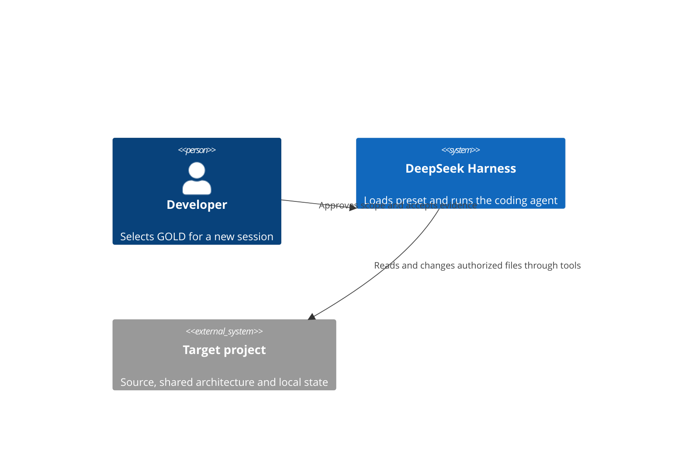
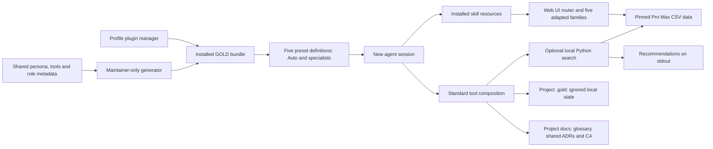
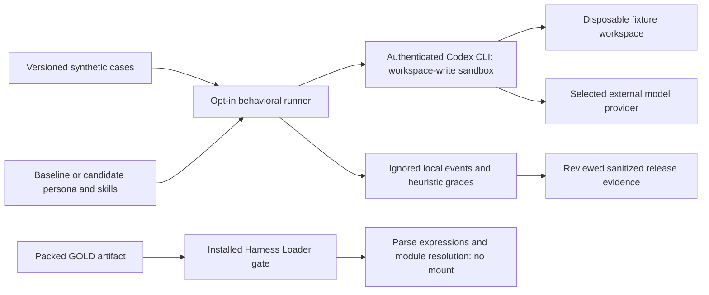

# GOLD preset architecture

This package is configuration and model-facing resources, not an independently deployed service.

## System context

## Runtime units and resources
A separate C4Container deployment view is not applicable: the bundle introduces no long-running service, network endpoint, database or container. Optional UI/UX Pro Max lookup starts a short-lived local Python process through the existing shell tool; it reads packaged CSV resources and returns stdout. Python is supplied by the host, not installed by the bundle.

## Contracts and boundaries
- The package manifest declares a generated Loader patch inserting five ordinary presets and no global tool overrides. Legacy `gold` remains GOLD Development; `gold-auto`, `gold-architect`, `gold-reviewer` and `gold-devops` add entry points.
- Build-time source holds shared persona/tool composition and small role metadata. Installed packages require no generator or native preset inheritance. Freshness tests prevent source/artifact drift.
- One packaged router discovers seven outcome playbooks, relevant engineering references and an on-demand index of eight domain specialties. Adapted resources ship with third-party license notices.
- Repository-only Git metadata validation reads candidate commits and GitHub event JSON through argument-array subprocess calls; it adds no runtime service, permission mode or automatic Git action. Branch naming is advisory in CI; model identity detection is heuristic.
- The existing scenario routing remains outcome-driven. Collaboration styles and changing focus are instruction/state concepts, not runtime preset switches or permission changes.
- The preset retains Standard's planning, compaction and delegation isolation. Only persona and skill discovery configuration differ.
- Skill discovery resolves from the installed package; project skills can shadow the custom root.
- All five personas route project vocabulary through packaged domain-modeling discovery and maintenance rules. Agents read the canonical glossary and maintain affected established terms within approved scope; no watcher, service, automatic rename or new permission boundary is introduced. Existing locations/context maps are preserved; absent conventions default to docs/glossary.md.
- Web UI routing selects one design lead and optional lookup/review/refinement; existing project systems and GOLD authorization remain authoritative. Shared foundations and capability-aware verification do not add browser tools or prove accessibility conformance.
- Pro Max crosses the existing authorized shell boundary into a host-provided Python 3 process. Its reviewed standard-library runtime reads bundled local CSVs; persistence is rejected at CLI/API and write helpers removed. Run with `-B` to avoid package bytecode caches. Shell redirection remains an independently scoped file write. CSV recommendations can contain external links/snippets; the runtime does not fetch or execute them. These data are guidance, not trusted instructions or asset licenses.
- Taste/Impeccable engines, hooks, detectors, telemetry, browser downloads and live editing are excluded. No automatic upstream update, tool installation or new runtime permission is introduced. Immutable manifests and complete third-party licenses ship with the skills; maintainer source downloads are not runtime dependencies.
- Model instructions guide behavior; they are not an enforcement layer. Runtime permissions and explicit user scope remain authoritative.
- Existing sessions retain their preset revision. Registration is not proof of behavioral compliance.
- Local state is not packaged and does not transfer through Git/worktrees. Shared docs must not rely on its availability.

## Maintainer validation boundary (since 1.3.0)

The repository-only evaluator starts an authenticated external CLI/model request only when explicitly invoked. It copies synthetic fixtures and selected resources into disposable workspaces, inspects tool-event traces and content differences, and retains raw logs locally. The provider sees the prompt/resources and synthetic fixture contents. Normal tests use no model requests. Neither evaluator nor runtime gate changes the active profile. The gate resolves modules from the explicitly selected runtime manifest and enforces real-path containment inside that runtime, or an explicitly supplied enclosing dependency root for hoisted installations; it does not discover or trust a broader root automatically. Working-content fingerprints exclude ignored inputs and do not act as approval or locks. Execution ledgers and budgets remain instruction-level records, not services.

## Validation
Source review against the manifest, declaration and resources; packaged YAML parsed through the explicit installed runtime gate. Behavioral adapter runs are separate from mounted-session evidence. Diagram syntax reviewed manually; no Mermaid renderer was run.

## Changes
| Change | Source |
|---|---|
| Initial declarative bundle baseline | package.json, cordis.patch.yml and packaged skill resources |
| Adaptive entry points and shared generation | preset-src, scripts/build-presets.mjs and generated cordis.patch.yml |
| Scenario/style discovery and engineering guidance | packaged router, collaboration and scenario/engineering references |
