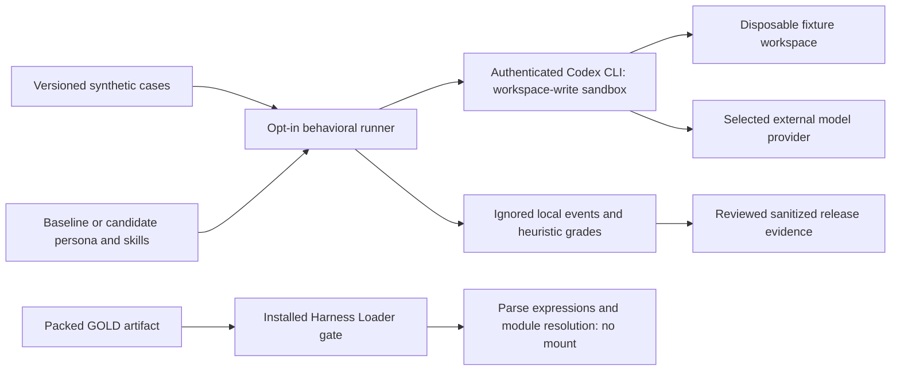

# Maintainer validation boundary

**State:** current source at migration baseline `09fd9cfeaaf1f0003b21de679f40bb6c6fc4d4ba`. **Scope:** repository-only validation tooling; the behavioral evaluator and installed runtime gate boundary has existed since 1.3.0. These are implemented checks, not a claim they ran for this migration. See the [architecture index](../README.md) for context and history.

## Behavioral evaluator

The repository-only evaluator starts an authenticated external CLI/model request only when explicitly invoked. It copies synthetic fixtures and selected resources into disposable workspaces, inspects tool-event traces and content differences, and retains raw logs locally. The provider sees the prompt/resources and synthetic fixture contents. Normal tests make no model requests.

Behavioral adapter runs are separate from mounted-session evidence: the adapter does not mount DSH presets or exercise DSH tools, modes, compaction and authorization. Its grades are heuristic and require review; only inspected, sanitized summaries should become release evidence. Neither the evaluator nor the runtime gate changes the active profile.

## Installed Loader gate

The gate checks a packed GOLD artifact against an explicitly selected installed Harness runtime. It parses packaged YAML, evaluates audited expressions and checks module resolution; it does not mount or activate the preset tree.

Module resolution is anchored at the selected runtime manifest. Real paths must remain inside that runtime or an explicitly supplied enclosing dependency root for hoisted installations. The gate does not discover or trust a broader root automatically. Parser/expression/resolution success is not proof of successful plugin activation, runtime isolation or model behavior.

## Other maintainer-only checks

Repository-only Git metadata validation reads candidate commits and GitHub event JSON using argument-array subprocess calls. It adds no runtime service, permission mode or automatic Git action. Branch naming is advisory in CI; model identity detection is heuristic and does not prove identity consent.

Working-content fingerprints exclude ignored inputs and are neither approval nor locks. Execution ledgers and budgets remain instruction-level records, not services. They do not create a new enforcement boundary.

## Evidence limits

The legacy view recorded source review against the manifest, declaration and resources, plus packaged YAML parsing through the explicit installed runtime gate. Retain that as historical evidence, not a fresh run: [runtime-check documentation](../../maintainers/runtime-check.md#inspected-contract-and-observed-evidence) records the inspected runtime and observed package identities, while [1.3.0 release evidence](../../releases/1.3.0.md) records behavioral results and gaps.

For this documentation migration, source inspection and manual diagram-syntax review are the evidence. No Mermaid renderer, behavioral evaluator, installed Loader gate or mounted session was run. Registration, structural tests and historical checks do not establish compliance of an active session. See the [validation guide](../../validation.md) for evidence classes and the separate operational instructions below before any authorized execution.

## Sources and validation

- [Behavioral runner](../../../scripts/eval-behavior.mjs), [synthetic cases](../../../evals/cases.json) and [evaluation guide](../../maintainers/behavior-evals.md): explicit model/tool execution, local evidence and grading limits.
- [Runtime gate](../../../scripts/check-runtime.mjs) and [runtime-check guide](../../maintainers/runtime-check.md): explicit roots, real-path containment, parse/expression/resolution scope and no mount.
- [Git validator](../../../scripts/check-git.mjs) and [Git conventions](../../maintainers/git-conventions.md): candidate-range inspection and advisory/heuristic limits.
- [Fingerprint implementation](../../../scripts/fingerprint.mjs) and [reliable-execution guide](../../user-guide/reliable-execution.md): content identity versus approval, budgets and ownership.
- [Behavior evaluator tests](../../../tests/behavior-eval.test.mjs) and [runtime gate tests](../../../tests/runtime-check.test.mjs): isolated regression contracts, not fresh-session activation evidence.
