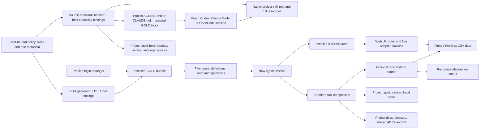

# GOLD resource structure

**State:** current source at migration baseline `09fd9cfeaaf1f0003b21de679f40bb6c6fc4d4ba`. **Scope:** build-time resources, host discovery and project knowledge, not an active deployment. See [system context](system-context.md) for actors and authority and the [architecture index](../README.md) for history.

## View applicability

GOLD is a resource bundle, not an independently running application. A separate C4 container view is not applicable: there are no GOLD application/service or data-store containers to decompose. The bundle introduces no long-running service, network endpoint or database. The resource flow below is not a container or deployment diagram. Optional [UI lookup](ui-lookup.md) starts a short-lived host-provided Python process through the existing shell tool; the bundle does not install Python.

The two consumption paths share policy and resources: DSH uses a generated bundle, while external hosts use project-local installation. The [host installation view](host-installation.md) details the filesystem write boundary; the [UI lookup view](ui-lookup.md) details the optional process and data boundary.

## DSH generation and composition

- The [manifest](../../../package.json) declares the generated [Loader patch](../../../cordis.patch.yml), which inserts five ordinary presets with no global tool overrides. Legacy `gold` remains GOLD Development; `gold-auto`, `gold-architect`, `gold-reviewer` and `gold-devops` add entry points.
- Build-time source separates [host-neutral policy](../../../preset-src/core-persona.txt) and [role metadata](../../../preset-src/roles.mjs) from [DSH bindings](../../../preset-src/dsh-adapter.txt) and [tool composition](../../../preset-src/shared-tools.yml). The [generator](../../../scripts/build-presets.mjs) emits the declarative bundle; installed DSH packages require neither the generator nor native preset inheritance. [Freshness tests](../../../tests/generation.test.mjs) guard source/artifact drift.
- Presets retain Standard's planning, compaction and delegation isolation. Only persona and skill-discovery configuration differ. [Preset contracts](../../../tests/preset.test.mjs) and the [maintainer Loader gate](maintainer-validation.md#installed-loader-gate) inspect composition rather than asserting live isolation behavior.
- Skill discovery resolves from the installed package; project skills can shadow the custom root. Genuine conflicts require resolution, not a claim that installing GOLD overrides the project.

## Guidance and project knowledge

The packaged [scenario router](../../../skills/gold-standard-development/SKILL.md) discovers seven outcome playbooks, relevant engineering references and an on-demand index of [eight domain specialties](../../../skills/gold-standard-development/references/specialties.md). Scenario/style discovery and engineering guidance are resources, not additional runtime units. Adapted resources ship with [third-party notices](../../../THIRD_PARTY_NOTICES.md).

All five personas route project vocabulary through packaged [domain-modeling discovery](../../../skills/domain-modeling/GLOSSARY-DISCOVERY.md) and [maintenance rules](../../../skills/domain-modeling/SKILL.md). Agents read the canonical glossary and maintain affected established terms within approved scope. Existing locations and context maps are preserved; absent conventions default to a project's `docs/glossary.md`. This adds no watcher, service, automatic rename or permission boundary.

Task-local `.gold/` state is ignored, is not packaged and does not transfer through Git/worktrees. Shared glossary, ADRs and C4 remain tracked project knowledge and must not rely on private state being available. The installer's `.gold-host/` configuration records have a separate purpose, described in [host installation](host-installation.md#outputs-and-discovery).

## Sources and validation

The linked manifest, declarations, generator, guidance and tests identify the source contracts behind this view. [Artifact policy](../../../skills/gold-standard-development/references/artifacts.md) defines the local/shared knowledge split. The [validation guide](../../validation.md) distinguishes freshness and static contract evidence from behavioral or mounted-session evidence.

This migration used source inspection, not a new generation, installation or runtime test. Diagram syntax review was manual only; no Mermaid renderer was run. The resource relationships retain the initial declarative bundle, adaptive shared generation and scenario/style guidance facts formerly listed in the legacy Changes table; [Git](../README.md#history) holds their history.
