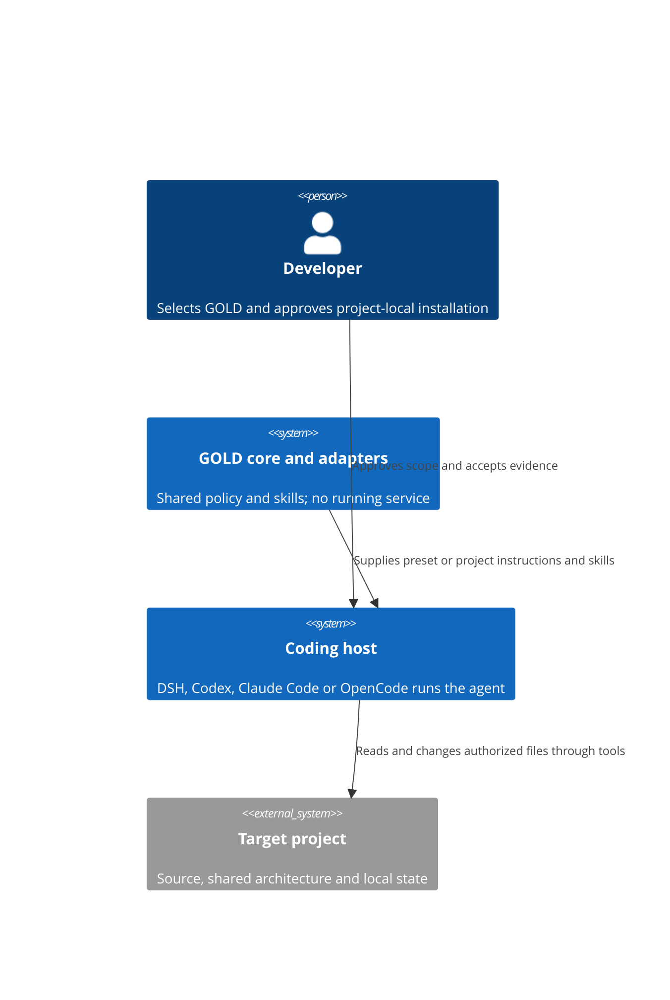

# GOLD system context

**State:** current source at migration baseline `09fd9cfeaaf1f0003b21de679f40bb6c6fc4d4ba`, not a claim about an installed or active session. **Scope:** people, GOLD resources, coding hosts and target projects. See the [architecture index](../README.md) for other views and history.

GOLD core supplies shared engineering policy and reusable skills through host adapters. The coding host runs the agent and exposes tools; GOLD itself supplies no running service, model or permission enforcement.

## Responsibilities and authority

- The developer selects GOLD, approves scope and any project-local installation, and accepts current verification evidence. Installation and delivery acceptance are distinct actions.
- GOLD core and adapters provide instructions and resource discovery. Model instructions guide behavior; they are not an enforcement layer. Runtime permissions and explicit user scope remain authoritative.
- The coding host executes tool operations against the target project. DSH consumes preset definitions; Codex, Claude Code and OpenCode consume project-local startup instructions and skills. Their capabilities and discovery rules remain host-specific.
- The target project owns its source, canonical glossary, shared architecture/ADRs and ignored local task state. Shared documentation must remain useful without private local records.

A role's initial focus, outcome-based scenario routing and Guided/Balanced/Delegated collaboration styles are instruction/state concepts, not runtime preset switches or permission changes. Registration alone does not prove behavioral compliance. Existing sessions retain their preset revision; a source change does not establish fresh-session discovery or activation.

## Sources and validation

- [Package manifest](../../../package.json): shipped configuration/resource surface.
- [Shared core persona](../../../preset-src/core-persona.txt), [role metadata](../../../preset-src/roles.mjs) and [DSH bindings](../../../preset-src/dsh-adapter.txt): scope, authority and host-facing entry points.
- [Portable-host guide](../../user-guide/portable-hosts.md): external adapter contract and fresh-session checks.
- [Canonical glossary](../../glossary.md): GOLD core, host adapter, preset, skill and delivery acceptance.

The diagram and prose were checked against source and existing documentation. Mermaid review was manual only; no renderer or live host session was exercised. See [evidence limits](../README.md#evidence-and-validation).
